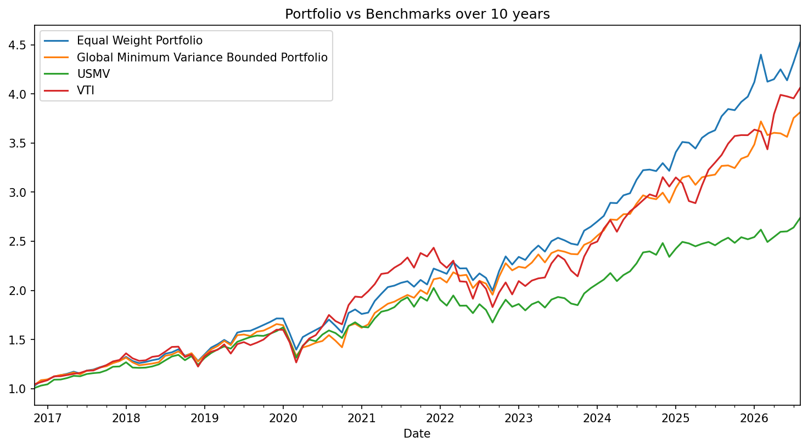

# Low-Volatility and Quality Equity Screener and GMV Portfolio

- Screens large-cap stocks across five markets for steady growth and low risk, then builds a global minimum variance (GMV) portfolio from the survivors.
- The portfolio matched VTI's performance while cutting volatility from 16.1% to 10.8% and max drawdown from 24.8% to 10.5% [confirm which portfolio and window these figures come from].

## Results

|                       |   Annualized Return |   Annualized Vol |   Skewness |   Kurtosis |   Cornish-Fisher VaR (5%) |   Historic CVaR (5%) |   Sharpe Ratio |   Max Drawdown |
|:----------------------|--------------------:|-----------------:|-----------:|-----------:|--------------------------:|---------------------:|---------------:|---------------:|
| EW Portfolio          |             0.16836 |          0.11865 |   -0.04097 |    2.86062 |                   0.04272 |              0.05947 |        1.13499 |       -0.12622 |
| GMV Bounded Portfolio |             0.14031 |          0.10957 |    0.10214 |    3.03283 |                   0.03915 |              0.05159 |        0.97985 |       -0.10452 |
| USMV                  |             0.07446 |          0.12131 |   -0.21123 |    2.35736 |                   0.053   |              0.06239 |        0.35658 |       -0.17352 |
| VTI                   |             0.11695 |          0.15985 |   -0.23766 |    2.63463 |                   0.06832 |              0.08864 |        0.52924 |       -0.24819 

- Risk-free rate used: 3%

- [Image 1: 10-year cumulative growth, all four portfolios against VTI and USMV (low volatility quality stock baseline)]

- [Image 2: 5-year cumulative growth, same lines]

## Screening criteria

- Markets: US, UK, France, Japan, Germany
- Market cap above $50bn
- Average daily volume above 500,000
- Return on equity above 10%
- P/E between 0 and 25
- Beta below 0.75
- Net income margin above 8%
- The P/E filter removed most technology names, along with some other sectors
- Universe: [x] stocks screened, [y] passed

## Portfolio construction

- Returns: yfinance data in local currency, no FX adjustment
- Covariance estimated on the last two years of data
- Ledoit-Wolf shrinkage applied to the covariance matrix
- Weight bounds: minimum 1/(3n), maximum 3/n, where n is the number of stocks
- Compared against an equal-weight portfolio, an unconstrained GMV portfolio and VTI
- Tested over 5-year and 10-year samples

- [Image 4: bar chart of the final bounded weights, with company names instead of tickers]

## Key findings

- The screen found stocks that compounded steadily, with performance in line with VTI and far lower volatility and drawdowns.
- The result is driven by the underlying stocks' reliable cash flows: mostly consumer staples and defensive assets.
- Shrinkage and weight bounds improved annual return while keeping the volatility and drawdown of the plain GMV portfolio.
- The 5- and 10-year results show bounded, shrunk weights hold up better than unconstrained GMV, which over-weights the lowest-volatility stocks and concentrates risk.
- Equal weight had the highest Sharpe ratio, but with worse volatility and drawdown. Its result comes from heavier exposure to tech names such as Apple and Microsoft, which did very well over the test windows.

## Limitations

- Stock selection bias: I chose the stocks from the screened list myself, and I leaned toward names that had done well, so results are flattered by hindsight.
- Outliers: a few stocks, such as Apple and Microsoft, had very large returns that pull up the averages.
- No rebalancing in the backtest.
- Local-currency returns, so FX movements aren't captured.
- Survivorship bias: the screen only includes companies that exist today.
- [Readdress] Covariance is estimated on the last two years, which overlaps the end of the 5- and 10-year test windows, so the most recent two years are in-sample. Say this plainly, or rerun with an earlier estimation window.

## How to run

- Install dependencies: `pip install -r requirements.txt`
- Keep `edhec_risk_kit_206.py` in the same folder authored by the authors of the EDHEC Investment Management with Python and Machine specialisations.

## Next steps

- Remove outlier stocks and rerun the results
- Backtest with periodic rebalancing
- Run factor regressions to explain the drivers of return and risk
- Explore machine learning approaches for weighting

| Ticker                          |   Weight |
|:--------------------------------|---------:|
| SAP SE SAP ORD SHS              |   0.0123 |
| ROCHE HOLDING AG ROCHE HOLDING  |   0.0631 |
| TOYOTA MOTOR CORP               |   0.0123 |
| Apple Inc.                      |   0.0123 |
| Automatic Data Processing, Inc. |   0.0273 |
| Agnico Eagle Mines Limited      |   0.0123 |
| AMETEK, Inc.                    |   0.0417 |
| AstraZeneca PLC                 |   0.0123 |
| Berkshire Hathaway Inc. New     |   0.0948 |
| AXA                             |   0.0707 |
| Cisco Systems, Inc.             |   0.0241 |
| HSBC Holdings PLC               |   0.0171 |
| International Business Machines |   0.0123 |
| IMI PLC ORD 28 4/7P             |   0.0319 |
| Lockheed Martin Corporation     |   0.0328 |
| Microsoft Corporation           |   0.0436 |
| Motorola Solutions, Inc.        |   0.0199 |
| Newmont Corporation             |   0.0123 |
| Novartis AG                     |   0.0336 |
| Pepsico, Inc.                   |   0.051  |
| Procter & Gamble Company (The)  |   0.0901 |
| SAFRAN                          |   0.0123 |
| Shell PLC                       |   0.0781 |
| AT&T Inc.                       |   0.036  |
| T-Mobile US, Inc.               |   0.018  |
| TOTALENERGIES                   |   0.0654 |
| Waste Management, Inc.          |   0.0623 |
